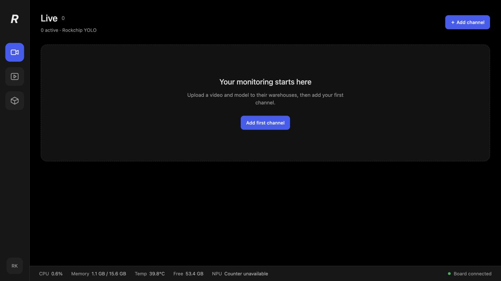
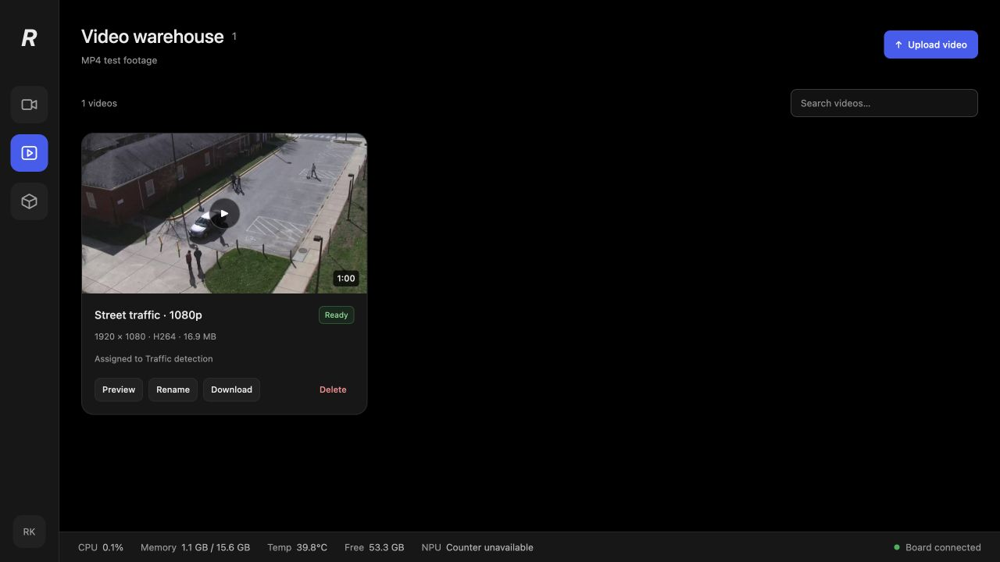
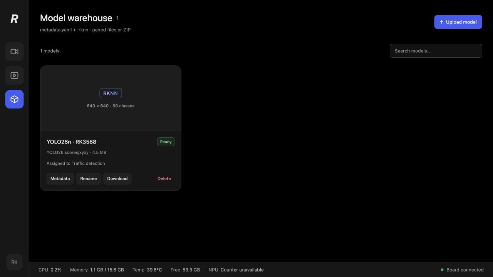

# Rockchip YOLO C++

A C++ demo for exploring YOLO detection performance on **RK3576 and RK3588**.

It uses MPP for video decoding, RGA for image preprocessing, and RKNN for NPU
inference. DMA-BUF lets these hardware blocks share image buffers. The web
dashboard gives you an NVR-style interface to try video sources, view detections,
record streams, and compare CPU and hardware preprocessing.

## Screenshots

Captured from the app running on RK3588. The running channel uses YOLO26n with
a 1080p video file.

| Empty dashboard                                                               | Dashboard with a running channel                                                                   |
| ----------------------------------------------------------------------------- | -------------------------------------------------------------------------------------------------- |
|                     |  |
| **Video manager**                                                             | **Model manager with an uploaded model**                                                           |
|  |               |

## Get started

Use a Debian/Ubuntu board image with working **MPP, RGA, and RKNPU drivers**.
Run these commands on the board:

```bash
cd rockchip-yolo-cpp
./nvr build
./nvr run
```

The first build needs internet access. It installs missing development packages
through apt, asks for sudo when needed, and downloads the private SDK/build
dependencies. It does not install or replace kernel drivers.

Open **http://BOARD_IP:8080** in your computer's browser. Replace `BOARD_IP` with
your board's IP address or hostname. The server listens on `0.0.0.0`; no SSH
forwarding is needed.

To use another port:

```bash
./nvr run --port 8088
```

Press **Ctrl-C** to stop the server and finish active recordings.

## Run your first detection

1. Open **Model warehouse** and upload a `.rknn` model with its `metadata.yaml`.
   You can choose each file separately, or upload a ZIP containing both.
2. If you want to test a video file, upload an MP4 in **Video warehouse**.
   You can also use an RTSP stream or a detected H.264 camera.
3. In **Dashboard**, click **Add channel**, choose the source and model, then
   click **Start**.

You can rename channels, change their settings, pause/resume, stop, or delete
them. Video-file channels also support seeking. Warehouses let you preview,
rename, download, and delete assets.

Use **H.264** for live browser playback. The engine can also decode 8-bit H.265,
but playback still depends on your browser's codec support. Camera input
currently requires H.264 over V4L2.

This demo has **no login**. Run it on a trusted LAN: anyone who can reach the
server can manage its channels and files.

## Compare CPU and RGA preprocessing

Edit a channel and switch its preprocessing mode between **RGA** and **CPU**.
Use the same source, model, and inference settings for both runs.

Only preprocessing changes. Both modes still use **MPP decoding and RKNN
inference**, so CPU mode is not a CPU-only detector.

| Dashboard value | What it tells you                           |
| --------------- | ------------------------------------------- |
| Video FPS       | Frames presented by your browser            |
| Decode FPS      | Frames decoded by the board                 |
| Inference FPS   | Frames processed by the model               |
| Preprocess time | Time spent preparing an image for the model |

Start with **Infer every N frames = 1**. If inference falls behind, the worker
drops older analytics frames. The browser keeps playing the original video at
its normal speed; it does not wait for detection results.

### Example result on RK3588

Measured with YOLO26n, 640×640 model input, and one 1080p H.264 RTSP source at
approximately 30 FPS. Each mode ran separately for 15 seconds.

| Mode              | Average preprocessing | Inference throughput |
| ----------------- | --------------------- | -------------------- |
| RGA               | 1.71 ms               | 29.8 FPS             |
| CPU preprocessing | 44.39 ms              | 15.1 FPS             |

Results depend on the model, source, board image, and concurrent workload.

## Choose a compatible model

Convert the model for the chip you will run it on: an RK3576 export should not
be assumed to work on RK3588. Its metadata must describe the same image size
and class names as the model.

| Model           | Current status                                                                 |
| --------------- | ------------------------------------------------------------------------------ |
| YOLO26          | Tested on RK3588 with Rockchip's two-output scores/xyxy export                 |
| YOLOv8 / YOLO11 | Compatible export layouts are implemented; YOLOv8 has not been board-validated |
| YOLOv10         | Not yet validated; standard post-NMS end-to-end exports are unsupported        |

The engine accepts batch-1 RGB detection models with one of these output layouts:

- Decoded single-output YOLO.
- Nine-output affine INT8 DFL.
- Two-output YOLO26: sigmoid class scores and pixel-space xyxy boxes.

Other layouts and tasks need additional postprocessing support. A model marked
**Ready** has passed runtime loading and tensor checks; that does not measure
its detection accuracy. RK3566 has not been validated.

## If hardware access fails

If you see an MPP/RGA permission error, check the device ownership and your groups:

```bash
ls -l /dev/mpp_service /dev/rga /dev/dri/renderD* /dev/dma_heap/*
id
```

If MPP/RGA are root-only, these commands grant access to the `video` group:

```bash
sudo usermod -aG video "$USER"
sudo chgrp video /dev/mpp_service /dev/rga
sudo chmod g+rw /dev/mpp_service /dev/rga
```

Log out and back in if your group membership changed. Device permissions may
reset after reboot; use your board image's udev rules for a permanent setup.
Missing device nodes usually mean the board image or drivers need attention.

## Files and recordings

Your settings, uploads, recordings, and logs live in **`.local/state/`**.
Builds, downloaded dependencies, and caches also live under `.local/`.

- Do not delete all of `.local/` to clean a build.
- Stop the server before backing up its state.
- Asset deletion moves files to `.local/state/trash/`; it does not immediately
  reclaim disk space. Remove channel references before deleting an asset.
- There is no automatic recording retention or live-source reconnect.
- The database stores absolute asset paths. Moving saved state to a different
  project location requires updating those paths.

## Build on an x86 Linux computer

The Docker cross-build targets **Ubuntu 26.04 ARM64**:

```bash
./nvr cross-build
```

Copy `.local/dist/rockchip-yolo-cpp-ubuntu26-arm64.tar.gz` to a matching board:

```bash
tar -xzf rockchip-yolo-cpp-ubuntu26-arm64.tar.gz
cd rockchip-yolo-cpp
./nvr run
```

The package includes the binaries, web assets, and shared libraries. It excludes
models and saved state. Install `ffmpeg` on the board if needed; video inspection
uses `ffprobe`. Older OS releases need a matching cross-build environment or a
native build.

Set `JOBS=8` to adjust build parallelism. Use
`CROSS_REBUILD_IMAGE=1 ./nvr cross-build` to refresh the cached Docker image.
Optional `UBUNTU_MIRROR` and `UBUNTU_PORTS_MIRROR` select apt mirrors.

## Find your way around the code

| Path                  | Purpose                                                |
| --------------------- | ------------------------------------------------------ |
| `src/engine/`         | MPP decoding, preprocessing, RKNN inference, recording |
| `src/worker/`         | Runs and controls one channel                          |
| `src/server/`         | HTTP/WebSocket API, warehouses, SQLite storage         |
| `web/`                | React dashboard                                        |
| `tools/`              | Setup, build, and packaging scripts                    |
| `config/example.json` | Configuration for the standalone CLI                   |

Start with **`src/cli.cpp`** to follow the hardware pipeline. For the web app,
start with **`src/server/main.cpp`** and **`web/src/App.tsx`**.

C++ uses four spaces and Allman braces. `.clang-format` defines the C++ style.

### Other commands

```bash
./nvr setup                              # Prepare dependencies
./nvr build --cli-only                   # Skip the web server/frontend
./nvr inspect /absolute/path/model.rknn   # Inspect model tensors
./nvr cli config/example.json            # Run the CLI after editing the example
```

To use existing SDKs, set `ROCKCHIP_SDK` to a directory containing `rga/` and
`rknn/`, and/or set `MPP_ROOT` to an MPP installation.
