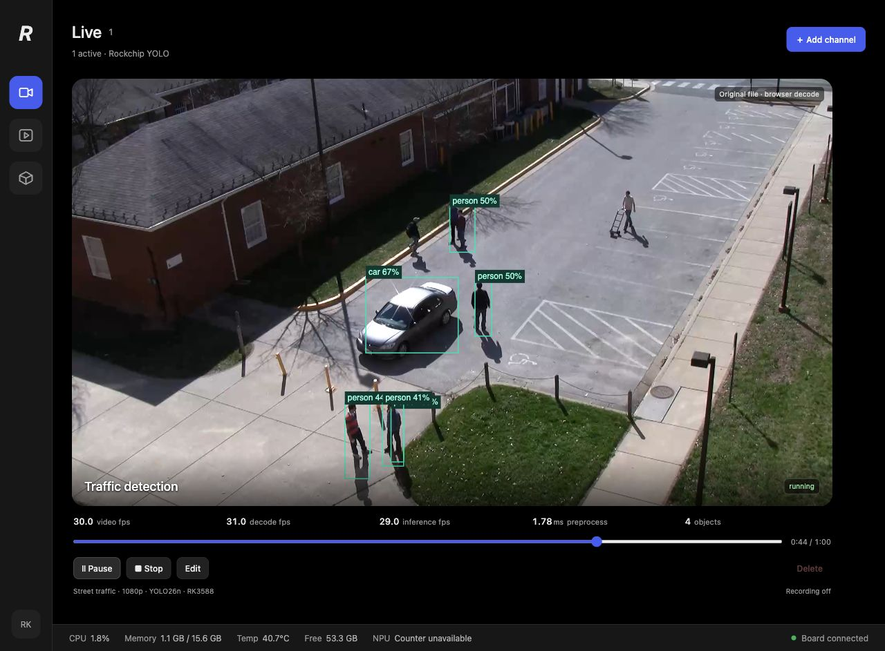

# Rockchip YOLO C++

YOLO object detection on **RK3576 and RK3588**, with a C++ engine and a web dashboard.
Uses **MPP** for video decoding, **RGA** for preprocessing, and **RKNN** for NPU inference.

[Download](https://github.com/Hanzo-Huang/rockchip-yolo-cpp/releases) ·
[Build from source](#build-from-source) ·
[Use the engine](#use-the-engine) ·
[Report an issue](https://github.com/Hanzo-Huang/rockchip-yolo-cpp/issues)



- RTSP streams, video files, and H.264 V4L2 cameras.
- Video playback, detection overlays, recording, and model/video uploads.
- Automatic parallel inference: two NPU workers on RK3576, three on RK3588.
- RGA and CPU preprocessing modes for comparison; both use MPP and RKNN.

## Quick start

Use a board image with working **MPP, RGA, and RKNPU drivers**. The prebuilt
package targets **Ubuntu 26.04 ARM64** and includes the application, shared
libraries, and web frontend. Models are supplied separately.

Download the runtime archive and `SHA256SUMS` from
[Releases](https://github.com/Hanzo-Huang/rockchip-yolo-cpp/releases), then run on the board:

```bash
sha256sum --check SHA256SUMS
tar -xzf rockchip-yolo-cpp-v0.1.0-ubuntu26.04-arm64.tar.gz
cd rockchip-yolo-cpp
./nvr run
```

Open **http://BOARD_IP:8080** in your browser. To change the port, use
`./nvr run --port 8088`. Press **Ctrl-C** to stop.

If `ffprobe` is missing, install it with `sudo apt install ffmpeg`.
Keep the extracted directory together; the executables need its libraries and web assets.

### Start a detection channel

1. In **Model warehouse**, upload a `.rknn` model and its `metadata.yaml`, or a ZIP containing both.
2. For a video file, upload an MP4 in **Video warehouse**. For a camera or RTSP stream, select it when adding a channel.
3. In **Dashboard**, choose **Add channel**, select the source and model, then **Start**.

Use **H.264** for live browser playback. The engine also decodes 8-bit H.265,
but browser playback depends on codec support.

**Run on a trusted LAN. There is no authentication.**

## Models and performance

Export each model for the board's chip: RK3576 and RK3588 need their own `.rknn`
exports. The metadata must match the model's input size and class names.

| Model/export | Support |
| --- | --- |
| YOLO26n, Rockchip two-output scores/xyxy | Tested on RK3576 and RK3588 |
| Decoded single-output YOLO; nine-output affine INT8 DFL | Implemented; compatibility depends on the export |
| Post-NMS end-to-end exports, segmentation, pose, OBB | Unsupported |

Models must have one batch-1 RGB image input. See
[RKNN Model Zoo](https://github.com/airockchip/rknn_model_zoo) for model export examples.
Inspect a model with `./nvr inspect /path/to/model.rknn`.

Single-channel tests with **YOLO26n, 640×640 input, RGA preprocessing, and a
4K 60 FPS H.264 RTSP stream** reached approximately **60 inference FPS on both boards**.
Throughput depends on the model and concurrent workload.

The dashboard reports decode and inference FPS separately from browser playback.
When inference falls behind, older queued frames are dropped so playback can continue.

## Build from source

On the board:

```bash
git clone https://github.com/Hanzo-Huang/rockchip-yolo-cpp.git
cd rockchip-yolo-cpp
./nvr build
./nvr run
```

The build command prepares dependencies, builds C++ with CMake, and builds the
React frontend. The first run needs internet access and may request sudo to
install packages. It does not install kernel drivers.

| Command | Purpose |
| --- | --- |
| `./nvr build --cli-only` | Build the CLI, worker, and model inspector without the web server/frontend |
| `./nvr cross-build` | Build and package Ubuntu 26.04 ARM64 on an x86_64 Linux host with Docker |
| `./nvr cli config/example.json` | Run without the dashboard; edit the example's model and source paths first |

Cross-build output is `.local/dist/rockchip-yolo-cpp-ubuntu26-arm64.tar.gz`.
Set `JOBS=8` to change build parallelism. Existing SDK installations can be
selected with `ROCKCHIP_SDK` and `MPP_ROOT`; see [tools/build.sh](tools/build.sh).

## Use the engine

Link the processing library from another CMake project:

```cmake
add_subdirectory(rockchip-yolo-cpp)
target_link_libraries(my_app PRIVATE nvr::engine)
```

Application targets are disabled by default when included this way.

| Interface | Purpose |
| --- | --- |
| [decoder.hpp](src/engine/decoder.hpp) | MPP decoding with frame and optional packet callbacks |
| [preprocess.hpp](src/engine/preprocess.hpp) | RGA/CPU preprocessing from borrowed NV12 image buffers |
| [detector_pool.hpp](src/engine/detector_pool.hpp) | Ordered inference across independent RKNN contexts |
| [postprocess.hpp](src/engine/postprocess.hpp) | YOLO tensor decoding, NMS, and source-image box coordinates |

For portable postprocessing only, set `NVR_BUILD_ENGINE=OFF` and link
`nvr::postprocess`. It needs neither the Rockchip SDK nor FFmpeg.
For a standalone hardware library build, set `NVR_BUILD_APPS=OFF`.

Channel orchestration lives in `src/worker/`, HTTP/WebSocket APIs in `src/server/`,
and the dashboard in `web/`. Start with [src/cli.cpp](src/cli.cpp) to follow the pipeline.
C++ changes should follow `.clang-format` and be validated on the affected boards.

## Data and limitations

- Settings, uploads, recordings, and logs are stored in **`.local/state/`**. Preserve this directory when cleaning builds or upgrading.
- There is no automatic RTSP reconnect or recording retention. Monitor recording disk usage.
- Hardware access requires read/write permissions for the board's MPP, RGA, NPU/render, and DMA-heap devices.

When reporting a problem, include the board, OS, RKNN runtime/driver versions,
model export details, and relevant logs. Do not include camera credentials.
